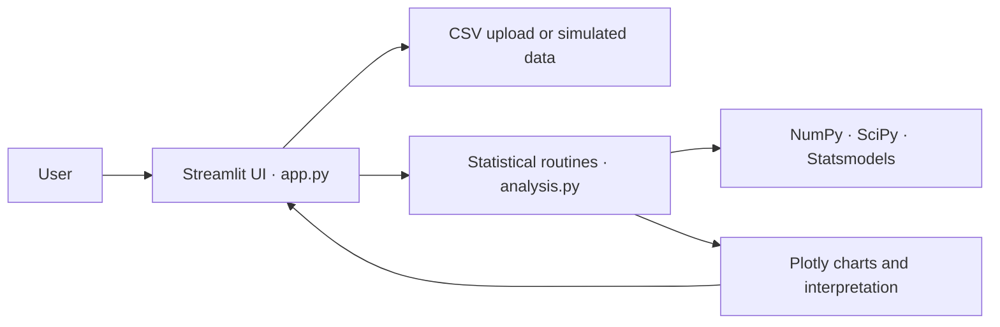

# Fieldnotes · Experimentation & Causal Inference Lab

A Streamlit workspace for designing A/B tests, analyzing outcomes, and exploring causal estimates when randomization is not available.

## What is included

- Reproducible simulated product experiment data, plus CSV upload.
- Power and sample-size planning for two independent means.
- Welch's t-test for continuous outcomes and a two-proportion z-test for binary outcomes, with confidence intervals and effect sizes.
- Bayesian conversion analysis using a Beta-Binomial model and an explicit uniform prior.
- Bonferroni and Benjamini-Hochberg multiple-testing correction.
- Two-period difference-in-differences and a constrained synthetic-control demonstration.
- Charts, plain-language interpretation, and visible notes on assumptions.

The app intentionally uses Streamlit as the user interface and runs the statistical routines in-process. It does not require a separate API service. DoWhy, EconML, PyMC, FastAPI, and React are not dependencies of this starter: the current Bayesian binary analysis is conjugate and exact, while the included causal routines are transparent lightweight implementations. Add those larger libraries when a production use case and dataset justify them.

## Run locally

Python 3.10–3.13 recommended.

```bash
python -m venv .venv
# Windows PowerShell
.venv\Scripts\Activate.ps1
# macOS / Linux: source .venv/bin/activate
python -m pip install -r requirements.txt
streamlit run app.py
```

## Deploy on Streamlit Community Cloud

1. Create a GitHub repository and push this project to its default branch.
2. In Streamlit Community Cloud, create an app from that repository.
3. Set the entrypoint to `app.py`, then deploy. `requirements.txt` is at the repository root.
4. No secrets are needed for the illustrative data or CSV upload demo.

## Data format

For experiment analysis, upload a CSV containing an assignment column with at least two groups and a numeric outcome column. Binary conversion should use `0` and `1`. Rows with missing assignment/outcome are excluded for the selected analysis. Uploads stay in the app process and are not persisted by this project.

For causal methods, use a tidy table with one row per unit-period observation, a group/unit column, a time/period column, and a numeric outcome. The difference-in-differences starter expects exactly two periods. The synthetic-control view requires multiple donor units and at least one pre- and post-intervention time point.

## Architecture



## Method notes and limitations

- Sample-size planning uses the independent-samples t-test approximation for a specified standardized mean difference, alpha, power, and allocation ratio. It does not currently plan binary outcomes, clustered designs, attrition, or sequential designs.
- The experiment page computes a fixed-sample analysis. Repeated peeking can inflate false positives; this demo does not implement alpha-spending or sequential testing.
- The Bayesian model is a Beta(1,1) prior for each arm's conversion rate. It reports posterior probability and credible interval, not a frequentist p-value.
- Difference-in-differences reports the raw two-period interaction contrast. Its key parallel-trends assumption cannot be established by the estimate.
- Synthetic control estimates nonnegative donor weights summing to one using pre-period outcome fit. It does not include uncertainty intervals or placebo inference.
- Multiple-testing adjustments apply to the outcomes selected in the UI; choose the family before examining results where possible.

## Suggested next steps

1. Add sequential testing with a validated alpha-spending implementation and simulations.
2. Add tests and benchmark scenarios before expanding method coverage.
3. Add covariate adjustment, propensity-score methods, uncertainty estimates for causal methods, and dataset-specific validation.
4. If the app needs multi-user persistence, access control, or an external client, separate the analysis layer behind FastAPI and add a React client. Keep secrets and uploaded data handling explicit.

## Project structure

```text
app.py              Streamlit pages, controls, charts, and interpretation
analysis.py         Statistical calculations
requirements.txt    Runtime dependencies
.streamlit/         Theme and server configuration
```
