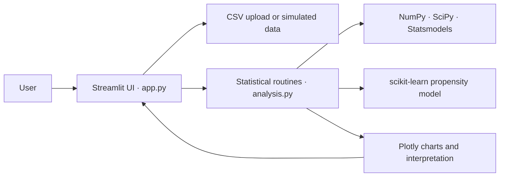

# Fieldnotes · Experimentation & Causal Inference Lab

A Streamlit workspace for designing A/B tests, analyzing outcomes, and exploring causal estimates when randomization is not available.

## What is included

- Reproducible simulated product experiment data, plus CSV upload.
- A sequential testing page that evaluates a pre-planned number of cumulative looks with Bonferroni family-wise error control.
- Power and sample-size planning for two independent means.
- Welch's t-test for continuous outcomes and a two-proportion z-test for binary outcomes, with confidence intervals and effect sizes.
- Chi-square tests of independence for categorical outcomes, with category shares, Cramér's V, and a sparse-cell warning.
- 1:1 propensity-score matching without replacement, with a logistic propensity model, caliper, ATT estimate, and before/after balance diagnostics.
- Bayesian conversion analysis using a Beta-Binomial model and an explicit uniform prior.
- Bonferroni and Benjamini-Hochberg multiple-testing correction.
- Difference-in-differences and a constrained synthetic-control demonstration.
- Charts, plain-language interpretation, and visible notes on assumptions.

The app intentionally uses Streamlit as the user interface and runs the statistical routines in-process. It does not require a separate API service. DoWhy, EconML, PyMC, FastAPI, and React are not dependencies of this starter: the current Bayesian binary analysis is conjugate and exact, while the included causal routines are transparent lightweight implementations. Add those larger libraries when a production use case and dataset justify them.

## Run locally

Python 3.10–3.13 recommended.

```bash
python -m venv .venv
# Windows PowerShell
.venv\Scripts\Activate.ps1
# macOS / Linux: source .venv/bin/activate
python -m pip install -r requirements.txt
streamlit run app.py
```

## Deploy on Streamlit Community Cloud

1. Create a GitHub repository and push this project to its default branch.
2. In Streamlit Community Cloud, create an app from that repository.
3. Set the entrypoint to `app.py`, then deploy. `requirements.txt` is at the repository root.
4. No secrets are needed for the illustrative data or CSV upload demo.

## Data format

For experiment analysis, upload a CSV containing an assignment column with at least two groups and an outcome column. Binary conversion should use `0` and `1`; continuous outcomes should be numeric; categorical outcomes can use labels or numeric codes. Rows with missing assignment/outcome are excluded for the selected analysis. Propensity matching uses complete cases across the selected treatment, outcome, and covariates. Uploads stay in the app process and are not persisted by this project.

For propensity-score matching, provide a binary treatment assignment, numeric outcome, and measured pre-treatment covariates. The app drops rows missing any selected field. For difference-in-differences and synthetic control, use a tidy table with one row per unit-period observation, a group/unit column, a time/period column, and a numeric outcome. Difference-in-differences uses the selected period as the first post-treatment period and averages across pre/post rows. The synthetic-control view requires multiple donor units and at least one pre- and post-intervention time point.

### Try the CSV upload demo

Download [`sample_data/demo_ab_upload.csv`](sample_data/demo_ab_upload.csv), choose **Upload CSV** in the app sidebar, then open **Experiment analysis**. Use `variant` for assignment and `converted` for the binary outcome.

Expected result: Control has 50/500 conversions (10%), Treatment has 100/500 (20%), and the estimated difference is +10 percentage points. The two-proportion z-test should give *z* ≈ 4.428 and *p* ≈ 0.0000095, with a 95% confidence interval of about +5.62 to +14.38 percentage points. At the default 5% threshold, the app should report a statistically significant difference. The data is synthetic and is meant to check the upload and analysis flow.

## Architecture



## Method notes and limitations

- Sample-size planning uses the independent-samples t-test approximation for a specified standardized mean difference, alpha, power, and allocation ratio. It does not currently plan binary outcomes, clustered designs, attrition, or sequential designs.
- The experiment page computes a fixed-sample analysis. Use the Sequential testing page for repeated looks; it applies a conservative Bonferroni boundary at preplanned checkpoints.
- Sequential testing uses a Bonferroni threshold of `alpha / planned looks` at fixed, equally spaced checkpoints in the ordered rows. The bound requires a fixed look count chosen in advance and valid per-look p-values. It is conservative and should not be treated as a substitute for a prespecified group-sequential design when early stopping is consequential.
- Chi-square analysis tests whether the selected category distribution differs by arm. Sparse expected counts can make the asymptotic p-value unreliable; the app flags a minimum expected count below five.
- Propensity-score matching estimates the ATT among treated observations that found a match. It uses 1:1 greedy nearest-neighbor matching without replacement on the logit propensity, with a default caliper of 0.2 SD. The reported interval is based on matched-pair differences and does not include uncertainty from fitting the propensity model. Matching cannot correct unmeasured confounding.
- The Bayesian model is a Beta(1,1) prior for each arm's conversion rate. It reports posterior probability and credible interval, not a frequentist p-value.
- Difference-in-differences compares average outcomes before and after a selected intervention cutoff. Its key parallel-trends assumption cannot be established by the estimate.
- Synthetic control estimates nonnegative donor weights summing to one using pre-period outcome fit. It does not include uncertainty intervals or placebo inference.
- Multiple-testing adjustments apply to the outcomes selected in the UI; choose the family before examining results where possible.

## Suggested next steps

1. Add covariate adjustment and stronger uncertainty estimates for causal methods.
2. Add tests and benchmark scenarios before expanding method coverage.
3. Validate method behavior on reference datasets and document dataset-specific assumptions.
4. If the app needs multi-user persistence, access control, or an external client, separate the analysis layer behind FastAPI and add a React client. Keep secrets and uploaded data handling explicit.

## Project structure

```text
app.py              Streamlit pages, controls, charts, and interpretation
analysis.py         Statistical calculations
requirements.txt    Runtime dependencies
.streamlit/         Theme and server configuration
```
